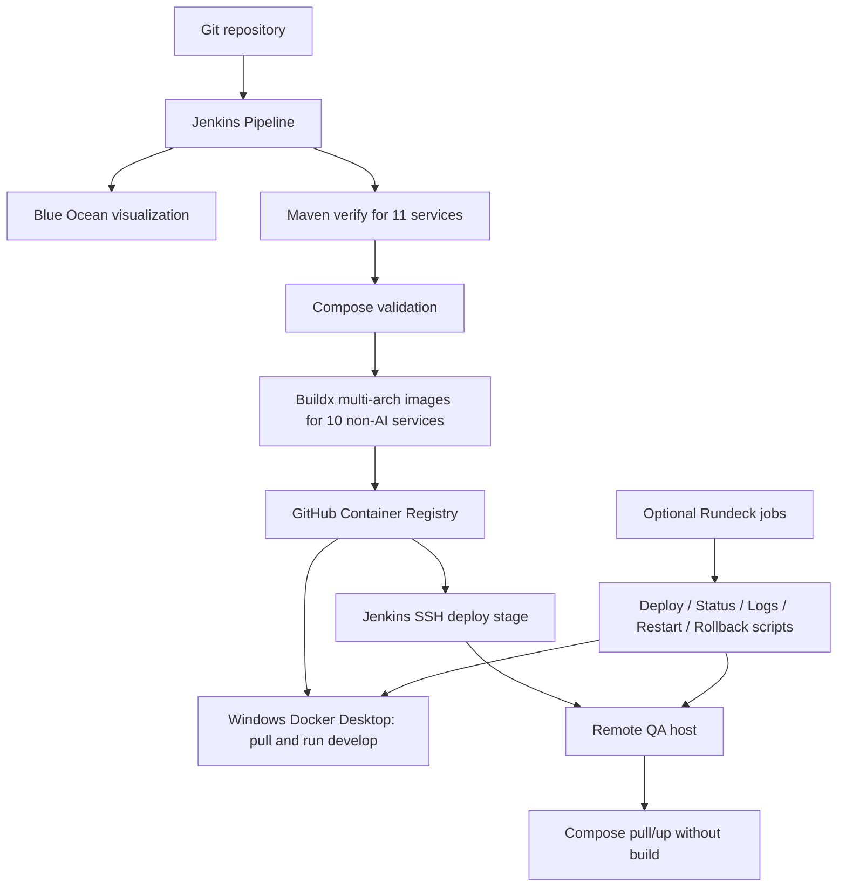

# Smart Factory CI/CD: Jenkins Blue Ocean and Rundeck-style Dev/QA operations

## Architecture

## Responsibility split

- **Jenkins** performs CI, tests, Docker builds, publishing, and authorized QA deployment.
- **Blue Ocean** visualizes the Jenkins stages.
- **GHCR** stores versioned images; the image tag is the short Git SHA for traceability.
- **Docker Compose** starts infrastructure and service containers.
- **Rundeck (optional)** can expose approved operational commands as parameterized jobs with access control and audit history. The repo provides `ops/smart-factory-runbook.sh`; it does not install Rundeck.
- **AI service** is verified by Maven but deliberately excluded from the image publish/deploy list to preserve the existing AI implementation without expanding it.

## Deployment model

1. Jenkins runs Maven `verify` for all service POMs.
2. Jenkins validates the Develop and QA Compose models using placeholder environment variables.
3. Jenkins uses the verified JARs with each service’s `Dockerfile.ci` (avoiding duplicate Maven compilation), then Buildx publishes the 10 non-AI service images to `ghcr.io/<owner>/smart-factory/<service>:<short-sha>` and `:latest`.
4. Windows local deployment is performed from PowerShell using `scripts/deploy-local.ps1`. It pulls images and runs Compose with `--no-build`; it does not build Java code on the laptop.
5. Remote QA deployment is an explicit pipeline parameter. Jenkins copies Compose files, pulls the selected image tag, and starts containers without building on the server.
6. Rundeck-style jobs can call `ops/smart-factory-runbook.sh` for status, logs, restart, deploy, and rollback to a known-good image tag.

## Safety and secrets

Never put passwords, PATs, private keys, or `.env` in source control. Store the GHCR write token and QA SSH credentials in Jenkins Credentials. Store a separate GHCR read-only token on the QA host. Keep SSH host key verification enabled. Do not expose Docker daemon access to untrusted jobs. Use QA-specific database credentials and protect production-like deployments with approvals.

## First-run checklist

- [ ] Put the project in a Git repository Jenkins can read (not performed by this package workflow).
- [ ] Configure a Linux agent with JDK 21, Maven, Docker Buildx, Git, and SSH tools.
- [ ] Install Jenkins Pipeline, Git, Credentials Binding, SSH Agent, JUnit, and ANSI Color plugins; optionally install Blue Ocean.
- [ ] Add the credentials listed in `jenkins/README.md`.
- [ ] Run with `DEPLOY_TARGET=none` first and fix any actual Maven/test failures.
- [ ] Confirm GHCR image packages exist with the expected short-SHA tag.
- [ ] Configure the QA host's `.env`, Docker Compose v2, SSH access, and GHCR read-only login.
- [ ] Run `DEPLOY_TARGET=qa-remote` and inspect container status and logs.
- [ ] On Windows, use `scripts/deploy-local.ps1` to pull the same tag into Docker Desktop.
- [ ] Run Postman API smoke tests and validate the device-simulator-to-Kafka-to-telemetry workflow.

## Important note

The repository's workflows and scripts are configuration only until run in your Jenkins environment. This archive preparation did not run Jenkins, publish images, deploy to QA, or run Git commit/push.
