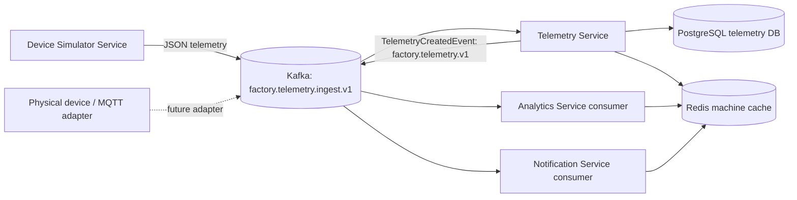
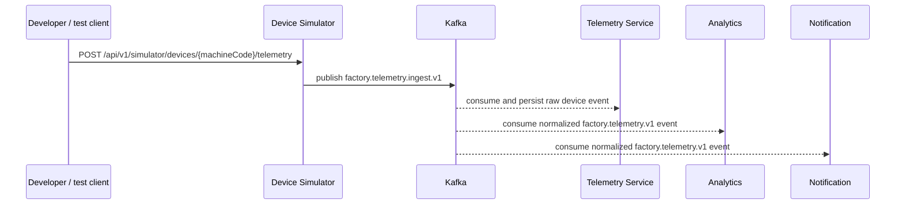

# Event-driven workflow and local development

## Telemetry workflow

The simulator publishes a JSON device-ingest event to `factory.telemetry.ingest.v1`; the telemetry service persists it and publishes a normalized event to `factory.telemetry.v1`. The simulator produces a JSON telemetry event with `eventId`, `machineCode`, `timestamp`, `machineState`, `metrics`, and `receivedAt`. The simulator is a test device source; it does not replace a production MQTT/OPC-UA adapter. The telemetry service validates machine identity using its existing machine client, persists telemetry, then publishes the created event. Analytics and notification consume the event independently using separate consumer groups.

## Simulation API sequence

## Run locally

1. Install Docker Desktop with Compose v2 and Java 21.
2. From the repository root, run `docker compose config` to validate the Compose file.
3. Start the stack with `docker compose up --build -d`.
4. Check containers with `docker compose ps` and logs with `docker compose logs -f <service>`.
5. Check health endpoints: `http://localhost:7074/actuator/health`, `http://localhost:7073/actuator/health`, `http://localhost:9090/actuator/health`.
6. Emit one simulated reading: `curl -X POST http://localhost:7074/api/v1/simulator/devices/MACHINE-001/telemetry`.
7. Emit a batch: `curl -X POST http://localhost:7074/api/v1/simulator/run -H "Content-Type: application/json" -d '{"machineCode":"MACHINE-001","count":20,"intervalMs":1000}'`.
8. Stop a running batch with `curl -X POST http://localhost:7074/api/v1/simulator/stop`.

## Important implementation notes

- Kafka uses the internal Docker DNS address `kafka:9092` inside Compose and `localhost:9092` from the host.
- Redis is available at `redis:6379` inside Compose and `localhost:6379` from the host.
- MySQL schemas are initialized by `infra/mysql/init.sql` only when the MySQL volume is first created. If you change this initialization script after the first start, create the schemas manually or reset the dev volume (`docker compose down -v`, destructive to local dev data).
- Compose generates a development-only RSA keypair in the `jwt_keys` volume. Do not copy that private key into source control or reuse it outside local development.
- AI service code and behavior are intentionally left unchanged.
- The simulator uses Kafka to generate events. Real physical devices need an authenticated adapter (e.g. MQTT) to bridge device messages into the same event contract.
