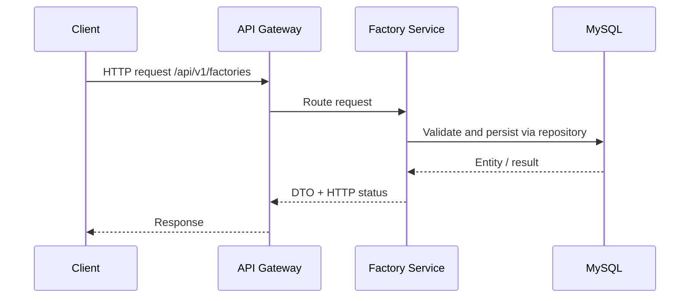
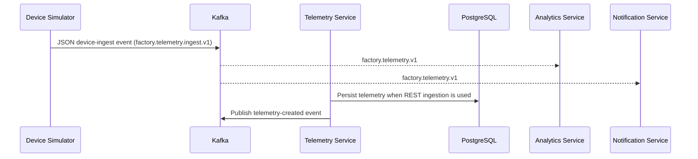

# Core API sequence diagrams

## Factory CRUD

## Telemetry ingestion and fan-out

Note: the current simulator-to-Kafka path and REST telemetry persistence are separate entry paths. A Kafka-to-telemetry persistence consumer is a follow-up integration; this keeps device simulation decoupled from the HTTP validation flow until a durable event-consumer/retry policy is selected.
